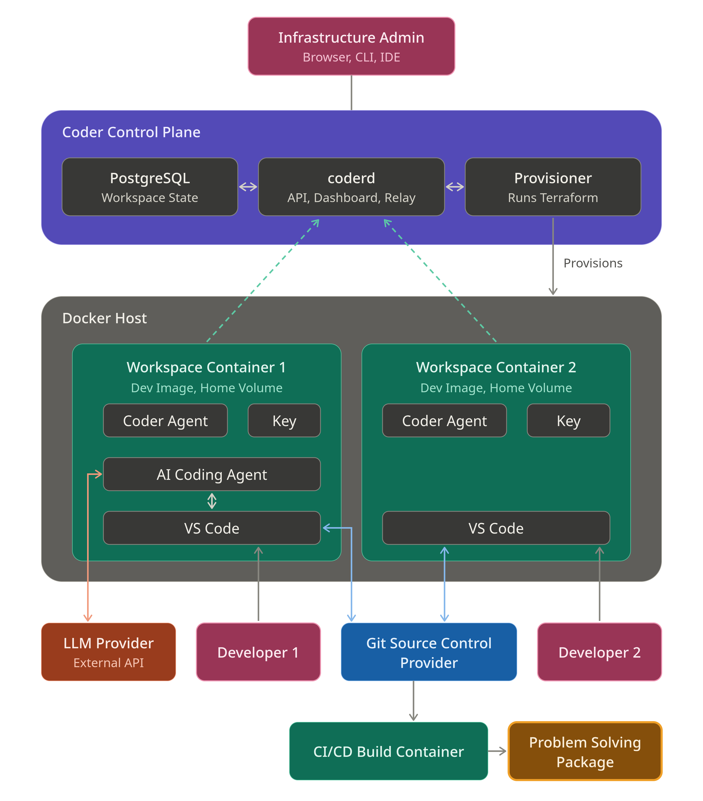

# Development of Fabric Supersat

This document provides development information for human and AI coding agents.

Information is provided on the development method, development architecture, how to build, test and extend the extension. For more on the extension itself, see [README.md](README.md).

## Development Method

This extension is developed using the human developer and AI coding agent architecture shown in Figure 1. The architecture provides a workspace container where developers and agents can work on code. The build container is a separate fresh environment for each build. In our experience, this method can produce more complete, higher-quality, and possibly safer problem solving packages in less time than a developer working alone.



Figure 1: Architecture for Developing Problem Solving Packages with AI Coding Agents

A suitably qualified and experienced developer for the problem domain guides where product development effort goes, and how coding progresses with the AI agent's greater recall, search capability, high-probability code generation, test and self-check loops provided by the coding harness, and its resulting general thoroughness. The developer's skills, the AI agent, coding harness, LLM, and resources provided are clearly critical factors determining the quality of the experience and outcome.

The developer explores and defines the needed features, guiding, and reviewing before committing and pushing to the Git Source Control Provider (e.g. GitHub). The AI agent can be granted almost full control within the workspace container during development, for example, to install needed testing packages. A key in the workspace is available to push code to the external Git Source Control Provider. A fresh container under the control of the Git Source Control Provider is spun up to build the Problem Solving Package from the source controlled code. Tests currently run only in the workspace container to conserve CI resources on GitHub. The built package can then be run by end-users to solve their real-world problems.

The developer regularly prompts the AI agent for information (options, best practices, standards, suggestions, summaries), reviews, and makes decisions, for example:
- Review the current repo for vulnerabilities and security issues.
- Review the current repo for structural and logic issues.
- Review the current repo, then add feature X.

In cases that warrant it, a third-party reviewer and tester may also be used.

## Getting Started

Building requires Node.js 22 or later (`@vscode/vsce` 4.x needs it; CI uses 22). The extension itself runs on the Node.js built into VS Code, which is why `@types/node` stays at the version matching the oldest supported VS Code (`engines.vscode` in `package.json`).

```sh
npm install
npm run watch        # type-check + rebuild on change
```

Press **F5** in VS Code and pick a launch config:

- **Run Extension (Desktop)** runs the Node.js extension host using `dist/node/extension.js`.
- **Run Extension (Web Worker)** runs the browser extension host inside desktop VS Code using `dist/web/extension.js`.
- **Extension Tests (Web Worker)** runs the shared tests in the browser extension host inside desktop VS Code, for debugging them.

To try it in a real browser: `npm run run:web`, then open http://localhost:3000.

## Scripts

| Script | What it does |
| --- | --- |
| `npm run compile` | Type-check, lint, and build both bundles. |
| `npm run package` | Production (minified) build. |
| `npm test` | Run tests in desktop VS Code (Electron). On headless Linux, use `xvfb-run -a npm test`. |
| `npm run test:web` | Run the shared tests in headless Chromium. Needs `npx playwright install chromium` once. |
| `npm run icon` | Re-render `icon.png` from `images/icon.svg`. Needs `npx playwright install chromium` once. |
| `npm run vsce:package` | Build a `.vsix`. |
| `code --install-extension ./vscode-fabric-supersat-0.0.1.vsix` | Install `.vsix` in VS Code. |

## Running Tests on Headless Linux

`npm test` downloads VS Code into `.vscode-test/` and runs the tests in it, and `npm run test:web` runs them in Playwright's Chromium. On a Linux machine or container with no desktop (SSH, WSL, Dev Containers, Codespaces, Coder), install a virtual display and the libraries VS Code and Chromium need once (Debian/Ubuntu):

```sh
sudo apt-get update && sudo apt-get install -y xvfb libnspr4 libnss3 libatk1.0-0 libatk-bridge2.0-0 libcups2 libcairo2 libgtk-3-0 libpango-1.0-0 libxcomposite1 libxdamage1 libxfixes3 libxrandr2 libgbm1 libxkbcommon0 libasound2t64 libatspi2.0-0

npx playwright install chromium   # for npm run test:web

sudo npx playwright install-deps chromium   # alternative: install only what Chromium needs (browser tests only)
```

On older releases (before Debian 13 / Ubuntu 24.04) the sound library is `libasound2` instead of `libasound2t64`. `libnss3` also installs `libnspr4`, the first library VS Code reports missing in a fresh container. Last checked on Ubuntu 26.04 with VS Code 1.147.

Then run:

```sh
xvfb-run -a npm test    # desktop tests (shared + desktop-only)
npm run test:web        # the shared tests in headless Chromium
```

If VS Code fails with `error while loading shared libraries: <name>.so`, list what's still missing with `ldd .vscode-test/vscode-linux-x64-*/code | grep 'not found'` (no output means nothing is missing). Find the package that provides a library with `apt-file search <name>.so` (from the `apt-file` package), and add it to the list above.

## Layout

```
src/
  extension.ts        shared activation (createExtension), used by both entry points
  node/
    extension.ts      desktop entry point (package.json "main")
    azureCli.ts       Azure CLI sign-in (desktop only: runs `az`)
  web/
    extension.ts      web entry point (package.json "browser")
  constants.ts        command IDs and the setting prefix
  auth/
    types.ts          TokenProvider interface, AuthError
    settings.ts       sign-in method, client ID and tenant (extension state, never settings files)
    service.ts        picks the sign-in method; requests made while a token is being fetched share it
    vscodeSession.ts  VS Code sign-in with your app registration
    pastedToken.ts    pasted access token (SecretStorage)
    jwt.ts            reads token claims (account, audience, expiry)
  fabric/
    client.ts         Fabric REST API client (paging, throttling, retries, long-running operations, errors)
    requestLimiter.ts when requests may be sent: a budget per Fabric quota bucket (Platform 180 at once then 5/s, operations 300 then 3/s), getDefinition at most 150 in any minute, at most 32 at once, bulk commands up to 128 notebooks at once; 429s pause the bucket (no vscode dependency)
    tenants.ts        lists the user's Entra tenants (Azure Resource Manager)
  features/
    feature.ts        Feature interface
    index.ts          list of registered features
    log.ts            "Show Log" command
    settings.ts       "Open Settings" command
    fabricAuth.ts     "Sign In", "Sign Out" and "Configure Sign-In" (method, client ID, tenant) commands
    workspace.ts      "Select Workspace" command and status bar item
    notebooks.ts      notebook download/upload/create/delete commands, switching between a notebook's .py and .ipynb, and the notebook editor
    notebookSync.ts   keeps each notebook's two files in sync: save hooks, .py file watcher, startup refresh
    workspaceTools.ts "Refresh Workspace Information", "Test Notebook Formats", "Compare All Notebooks with Workspace", "Compare Notebook with Workspace"
    workspaceSync.ts  "Sync Workspace": fetches and compares every notebook (reusing workspaceTools' comparison and diff view), lists the changes, then uploads/downloads/deletes with transfer.ts
  notebooks/
    format.ts         Fabric Git format (.py) <-> Jupyter (.ipynb) conversion (no vscode dependency)
    files.ts          a notebook's two local files, by name, and syncing them (one sync at a time per notebook)
    serializer.ts     opens src/Notebooks/<Name>/<Name>.py in the notebook editor
    transfer.ts       download and upload (by name) against the Fabric API
    folders.ts        workspace folders by path (`folder` in notebook.yaml): Fabric's folder name rules, paths by folder ID, creating missing folders one path at a time (no vscode dependency)
    support.ts        which notebooks are supported: notebook language from its files, and why not (no vscode dependency)
    definition.ts     the parts (files) of a notebook definition from Fabric (no vscode dependency)
    remote.ts         notebooks as they are in Fabric (fetched without writing), and header summaries (no vscode dependency)
    formatTest.ts     the format checks, their report, and replacing IDs in samples (no vscode dependency)
    notebookSettings.ts src/fabric-supersat.yaml: the committed notebook reference settings (used in every mode)
    references.ts     lakehouse/environment references: pointed at the target workspace's items (by name) on upload, "current workspace" on download (no vscode dependency)
  workspace/
    metadata.ts       collects workspace information and renders <Workspace Name>.md; how a notebook compares with its local .py, and its description and folder with notebook.yaml (no vscode dependency)
    notebookCache.ts  notebooks-cache/<Notebook Name>/: each notebook as last fetched (Fabric's file + cache-info.json, with its description and folder), written by a refresh, kept current by download/upload/delete, read by Compare All
    state.ts          per-workspace folders in .fabric-supersat/workspaces/, sync state for Upload Changed, batched JSON file updates (changes made during a write are saved together in the next)
    sync.ts           "Sync Workspace" planning: which notebooks change, and how, in each direction, from their comparison statuses (no vscode dependency)
    service.ts        selected Fabric workspace, saved by name (in settings.yaml, kept in sync with the user setting); ID looked up in Fabric; its picker
    projectSettings.ts .fabric-supersat/settings.yaml: the workspace name stored there (not used in Restricted Mode)
  util/
    config.ts         typed settings accessor
    errors.ts         shows an error with buttons for its fix, and logs it: a warning ("<command> could not proceed: …") or an error
    errorFix.ts       how errors carry their fix (or say they're quiet), so util doesn't depend on who throws them
    progress.ts       progress notification helper
    localState.ts     project folder, the git-ignored .fabric-supersat folder, symlink-safe write check
    base64.ts         base64 for item definition parts (desktop and web)
    yamlFile.ts       reads and updates YAML files, keeping comments and layout
    logger.ts         shared LogOutputChannel (lines also copied to .fabric-supersat/logs/)
    diagnostics.ts    request timing, log and history files in .fabric-supersat, per-command Starting/Finished lines and summaries
    commands.ts       registerCommand: every command is registered through it, so each logs Starting and Finished lines
    concurrency.ts    runs a limited number of tasks at once, results in order
    keyedLock.ts      runs tasks with the same key one at a time (uploads of one notebook)
    json.ts           reading untyped JSON (isObject, asObject, nonEmptyString)
    names.ts          matching Fabric item names (exact, then ignoring case)
    text.ts           line endings: compare as LF, keep a file's own when rewriting
    markdown.ts       escaping Fabric's text (names, descriptions, notebook lines) in generated Markdown pages
    folderNames.ts    the rules for folder names from Fabric names (notebooks, their samples, workspaces): check or encode
  test/
    suite/*.test.ts   tests that run on both desktop and web
    suite/memFs.ts    in-memory file system for tests that read and write files; reports changes, so watchers see them
    suite/memento.ts  in-memory Memento (extension state) for tests
    suite/jwtHelper.ts fake access tokens (JWTs) for tests
    suite/fixtures/   real Fabric exports used as test data (add more as formats are confirmed)
    node/*.test.ts    desktop-only tests
    web/index.ts      browser mocha runner (imports test files explicitly; a desktop test checks none are missing)
schemas/              JSON schemas for the YAML files (package.json "yamlValidation")
esbuild.mjs           builds dist/node, dist/web and the web test bundle
images/icon.svg       icon source (npm run icon renders it to icon.png)
scripts/render-icon.mjs renders images/icon.svg to icon.png (npm run icon)
.github/workflows/build.yml CI: type-check, lint and package the .vsix on each push and pull request (no tests)
```

## Adding a Feature

1. Create `src/features/myFeature.ts` that exports a `Feature` and registers its disposables on `context.subscriptions`. Register commands with `registerCommand(id, title, handler)` from `src/util/commands.ts`, not `vscode.commands.registerCommand`, so they log their Starting and Finished lines. Its `activate(context, services)` also receives shared services, such as `services.auth` for Fabric tokens, `services.fabric` for the Fabric API and `services.workspace` for the selected workspace (`await services.workspace.resolve()` returns it, asking the user only if none is saved), and `services.notebookSettings` for the project's `src/fabric-supersat.yaml` (`await services.notebookSettings.read()` gives the notebook reference settings in effect; commands that write or upload notebooks call `services.notebookSettings.createFile()` first).
2. Add it to the array in `src/features/index.ts`.
3. Declare its commands, settings, views and so on under `contributes` in `package.json`, and add the IDs to `src/constants.ts`.
4. Add tests in `src/test/suite/`, and import new test files in `src/test/web/index.ts` (the desktop tests fail if one is missing).

## Files for People: YAML

Files the extension writes for people to read and edit (local settings now, item metadata later) are YAML, with the `.yaml` extension. Read and write them only through `src/util/yamlFile.ts`, so they all behave the same way:

- `updateYamlFile` changes only the values it is given, keeping comments, key order, blank lines and end-of-line comments. A new file starts from a template whose comments explain it, with placeholders (`id: ""`) that keep each comment next to its value.
- Strings are written double-quoted, so IDs, names and dates are never read back as numbers or booleans. Read values with the typed accessors such as `YamlFile.getString`.
- A file with YAML errors is never overwritten. `YamlFileError` names the file and line.

Give each file a JSON schema in `schemas/` and register it under `yamlValidation` in `package.json`. With Red Hat's YAML extension, people then get autocomplete, hover descriptions and typo warnings. Put the explanation in each property's `description`, since that is what people see on hover. Keep `additionalProperties: false` so typos are flagged, and add new keys to the schema when a feature adds them.

Local, per-person files go in `.fabric-supersat/` in the project folder, which git ignores through the `.gitignore` the extension creates there.

## Errors and Warnings

Errors that reach `reportError` (`src/util/errors.ts`) are logged and shown at one of three levels, decided by the error itself (`src/util/errorFix.ts`):

- **Info**, not shown: the user cancelled (`QuietError`, e.g. `AuthCancelledError`).
- **Warning**, "<command> could not proceed: …": something the user sees to, not a failure (`WarningError`). Throw `ActionNeededError`, or give the error class `readonly warning = true`, for situations such as a declined sign-in, no workspace with the saved name, an unsupported notebook, a bad setting value or unsaved changes. `FabricApiError` is a warning for 401 and 403. `AuthError` is a warning unless constructed with `{ unexpected: true }`. In bulk commands such a notebook counts as skipped.
- **Error**, "<command> failed: …", with its stack trace: anything else. That means a bug, or Fabric or the file system failing unexpectedly. Never throw a plain `Error` for something the user can fix.

Pass `reportError` the command's title as it appears in the Command Palette, e.g. `'Download All Notebooks'`.

## Desktop and Web Rules

Feature code runs in both a Node.js host and a browser **web worker**, so:

- Use `vscode.workspace.fs` and `vscode.Uri`, not `fs` or `path`.
- Use `fetch`, not `http`/`https`.
- Don't spawn processes or use other Node-only modules in shared code. Put desktop-only code in `src/node/` and wire it in from `src/node/extension.ts` (as the Azure CLI sign-in is). Its tests go in `src/test/node/`.
- Don't assume `file://` URIs. Workspaces may be virtual (`vscode-vfs://`, `vscode-test-web://`).

## Before Publishing

- The extension ID is `publisher.name`; keep `EXTENSION_FULL_ID` in `src/constants.ts` in sync if either changes.
